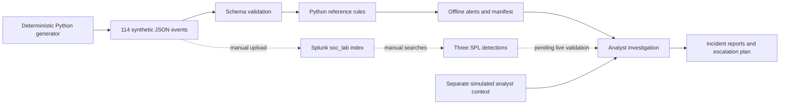

# Splunk SOC Alert Triage and Incident Investigation Lab

**Adeel Akheel · SOC analyst portfolio · Synthetic training environment**

Investigate three alert types—failed logons, encoded PowerShell, and scheduled-task creation—and connect them into one evidence-based case. Compare each with a benign lookalike before deciding what to escalate.

**Status:** the offline demo is implemented and tested. SPL searches and ingestion configuration are provided for manual Splunk validation; **no searches have been executed in a live Splunk instance**. This project contains generated JSON representations of Windows events, not captured EVTX evidence or a production incident.

## Start in two commands

Requires Python 3.10+; standard library only. From this repository folder:

```sh
python3 -m soclab demo
python3 -m unittest discover -s tests -v
```

On Windows, use `py -3` instead of `python3` if needed. The demo writes `data/telemetry.jsonl` and `results/`. It generates text only: no PowerShell, authentication attempts, tasks, network requests, or host changes are performed.

Expected fixture output: **114 events, 6 alert groups**. Three alerts belong to the focus case; three are deliberately benign lookalikes. These are fixture counts, not accuracy, performance, or production-impact metrics.

## What to review

| Start here | Purpose |
|---|---|
| [Investigation walkthrough](docs/walkthrough.md) | Follow the focus incident from alert to escalation |
| [Full case report](reports/IR-001-focus-investigation.md) | Evidence, timeline, confidence, gaps, and response plan |
| [Authentication case](reports/IR-002-authentication.md) | Password-guessing hypothesis vs. stale credentials |
| [Scheduled-task case](reports/IR-003-scheduled-task.md) | Task creation vs. proof of execution |
| [False-positive analysis](docs/false-positives.md) | Compare all three benign lookalikes and propose narrow tuning |
| [Splunk setup](docs/splunk-setup.md) | Ingest the fixture and check actual search results |
| [Detection catalog](docs/detection-catalog.md) | Logic, field dependencies, blind spots, ATT&CK mappings |
| [Validation record](docs/verification.md) | What was verified locally and what remains untested |
| [Interview and resume notes](docs/portfolio.md) | Explain the work without overstating the results |

## Architecture



The Python reference rules do not execute SPL. Ground-truth context is stored separately and never consulted by either detection implementation. The lab uses `Computer` as the originating endpoint; Splunk's ingest `host` may be the uploader.

## Scenarios

| Scenario | Signal | Benign comparison | Investigation question |
|---|---|---|---|
| Authentication | Eight failures for one account/source/host in a five-minute bucket, then success | Six backup-account failures after a simulated credential rotation | Is the activity authorized, and what followed the successful logon? |
| PowerShell — focus case | Encoded PowerShell on the same host/logon session | An approved deployment-agent marker | What does the decoded content do, and how strong is the session linkage? |
| Scheduled task | Task executable under `C:\Users\Public` | An approved temporary maintenance marker | Who created it, what triggers it, and is there evidence it ran? |

The focus case represents an unapproved simulation, not real malware. Its decoded script is only `Write-Output 'SOC-LAB marker only'`. All hosts, accounts, tickets, and analyst context are fictional. IPs use documentation ranges.

## Repository map

```text
soclab/       Offline generator, schema checks, reference rules, CLI
tests/        Detection boundaries, negative cases, reproducibility, CLI checks
data/         Synthetic telemetry and separate simulated analyst context
detections/   Three SPL detections, timeline pivot, ingestion check
splunk/       Minimal JSON ingestion app and optional monitor example
docs/         Setup, schema, walkthrough, tuning, sources, portfolio notes
reports/      Detailed focus report, two supporting reports, reusable template
results/      Reproducible alert output, manifest, summary, test log
```

Additional commands:

```sh
python3 -m soclab validate data/telemetry.jsonl
python3 -m soclab detect data/telemetry.jsonl
python3 -m soclab evidence data/telemetry.jsonl AUTH-009 PS-001 PS-002 TASK-001
python3 -m soclab demo --out /tmp/soc-lab-reproduction
```

The last command writes to the supplied directory; choose a disposable folder. Regenerating the default demo overwrites only the generated telemetry and result files, preserving reports and analyst context.

## Boundaries

This is a focused analyst lab, not an EDR, SOC automation platform, or complete detection suite. No production deployment, dashboard, live alert scheduling, native EVTX parser, or automatic containment is included. Small synthetic fixtures cannot establish real-world precision or recall. Windows XML/add-on field normalization, timestamp ingestion, SPL execution, permissions, and live collection must be verified in an actual environment. See [field contract](docs/field-contract.md) and [limitations](docs/detection-catalog.md#known-limitations).

MIT license. Published as a synthetic training lab; live Splunk validation remains pending.
